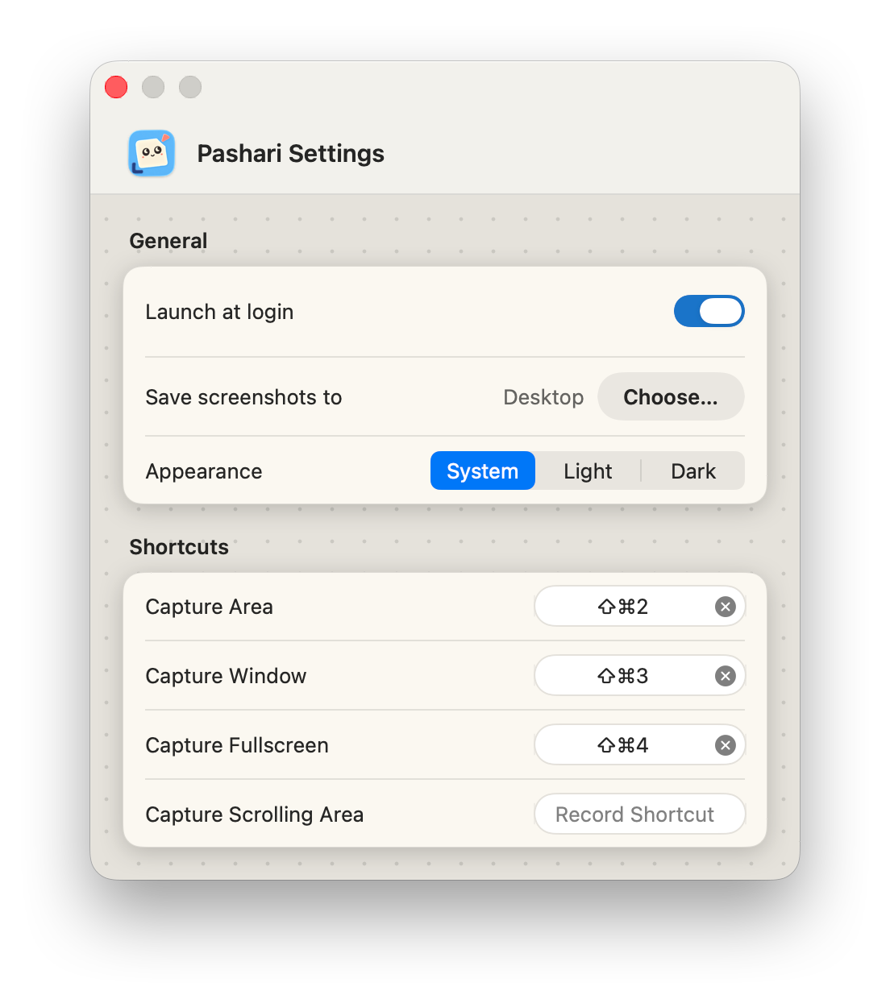

# Pashari

A menu bar screenshot app for macOS, written in Swift.

> **Status:** early development.

<p align="center">
  
</p>

## Features

- Capture an area, a window or the full screen, from the menu bar or with
  global hotkeys
- Scroll capture: pick an area, scroll its content, and get one tall
  picture of everything that scrolled past
- A floating thumbnail after each capture, like an instant photo: copy,
  save, annotate, drag it into another app, or close it. Captures pile up
  in the corner; rest the pointer on the pile to spread them out
- An annotation editor: arrow, rectangle, ellipse, line, pen, multi-line
  text, numbered badges, blur, crop, with undo and redo
  - Select a mark to move or delete it
  - Hold Shift for straight lines, squares and circles
- Saves PNG files at full Retina resolution, to the Desktop or a folder of
  your choice
- Names files like `pashari-20260728-bnan.png`: the date, then the time of
  day as four letters, so sorting by name keeps them in the order taken

<p align="center">
  
</p>

Up to five thumbnails lie on the pile, as many as fit on screen when
spread out. Older captures wait until space is available: copy, save, or
close thumbnails to reveal them. Quitting asks for confirmation while
screenshots remain in thumbnails or editors.

Working PNGs live in a directory for each run under
`~/Library/Application Support/Pashari/PendingCaptures`, which is excluded
from Time Machine. Quitting removes that run's files. If a run is interrupted,
Pashari offers to restore its working PNGs to the thumbnail stack, discard them,
or leave them for a later launch.

Default hotkeys (change them under Settings):

| Action             | Hotkey |
| ------------------ | ------ |
| Capture area       | ⇧⌘2    |
| Capture window     | ⇧⌘3    |
| Capture fullscreen | ⇧⌘4    |

Capture Scrolling Area has no hotkey until you set one under Settings.

macOS uses ⇧⌘3 and ⇧⌘4 for its own screenshots. Turn those off under
System Settings > Keyboard > Keyboard Shortcuts > Screenshots so that
Pashari gets them.

Settings opens from the menu bar icon. If the icon is hidden, for example
behind the notch, open Pashari again from Spotlight or the Finder and
Settings appears.

<p align="center">
  
</p>

### Scroll capture

Select the part of a window that scrolls, wait until the bar next to it
prompts you to scroll, then scroll it as usual.
Pashari records the area and adds whatever scrolls into view to the bottom
of the picture. Click Done or press Return to finish; Escape cancels. After
a click in another app, Return and Escape go to that app until you click
Pashari's bar again.

- A fixed header or footer inside the area, such as a toolbar, appears
  once, at the top or bottom of the picture.
- Leave out parts beside the content that do not scroll along, such as a
  sidebar: they keep Pashari from telling how far the content moved.
- If you scroll faster than Pashari can follow, it says so. Scroll back a
  little, and carry on more slowly.
- The picture stops growing at 30,000 pixels (less for very wide areas).

## Installing

Pashari needs macOS 14 or later.

Download `Pashari-<version>.dmg` from the
[latest release](https://github.com/juninaba/pashari/releases/latest),
open it, and drag Pashari to Applications. Or download the `.zip` there,
unzip it, and move Pashari to Applications.

Releases are not signed with an Apple Developer ID or notarized by Apple,
so macOS blocks each new version the first time you open it:

1. Open Pashari. macOS says it cannot verify Pashari; close the message
   without moving Pashari to the Trash.
2. Open System Settings > Privacy & Security, scroll down to Security, and
   click Open Anyway next to the message about Pashari. The button stays
   for about an hour after you tried to open Pashari.
3. Confirm that you want to open it. macOS may ask for your login password.

From then on Pashari opens like any other app.

The first capture asks for the Screen Recording permission. Grant it in
System Settings, then quit and reopen Pashari.

Without a Developer ID, each release has a signature of its own, so macOS
treats an update as a different app and does not carry the Screen
Recording permission over. After updating, select Pashari under System
Settings > Privacy & Security > Screen & System Audio Recording, remove it
with the − button, and take a capture. macOS then asks for the permission
as it did the first time: turn Pashari on, then quit and reopen it.

## Building

Building needs Xcode 26 or later and
[XcodeGen](https://github.com/yonaskolb/XcodeGen) (`brew install xcodegen`).
The Xcode project is not checked in. It is generated from `project.yml`:

```sh
xcodegen generate
open Pashari.xcodeproj
```

Then build and run the `Pashari` scheme. From the command line:

```sh
xcodebuild -scheme Pashari build
xcodebuild -scheme Pashari test
```

### Signing

By default the app is signed ad-hoc ("Sign to Run Locally"), so it builds
without an Apple ID.

macOS ties the Screen Recording permission to the code signature, and an
ad-hoc signature changes on every build, so you would have to grant the
permission again after each build. To avoid that, sign with your own
development certificate:

```sh
cp Config/Local.xcconfig.example Config/Local.xcconfig
```

and put your team ID in `Config/Local.xcconfig`. That file is git-ignored.

## License

[MIT](LICENSE)
